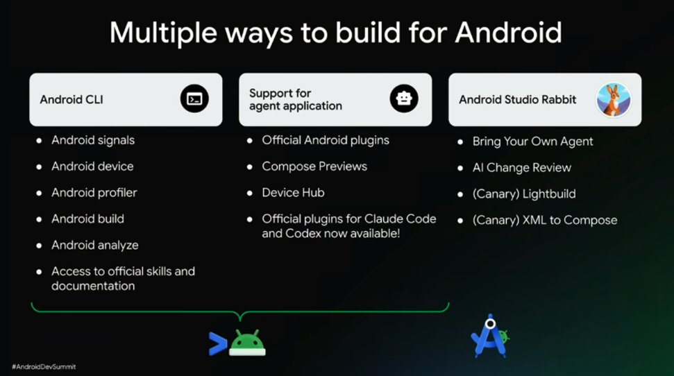
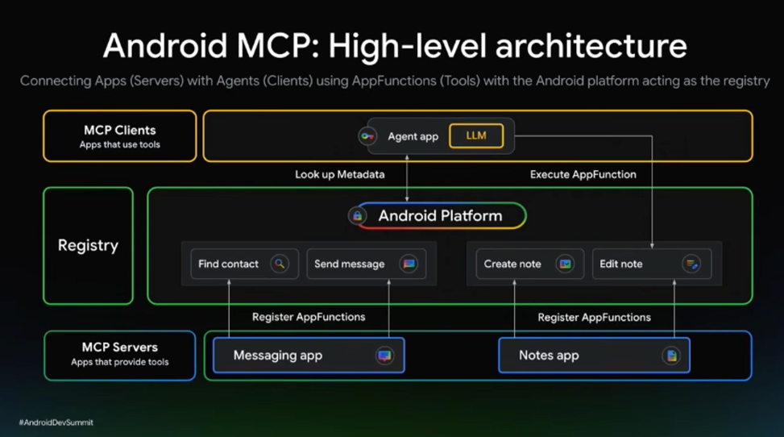
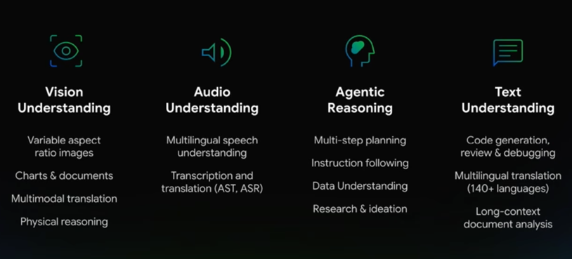
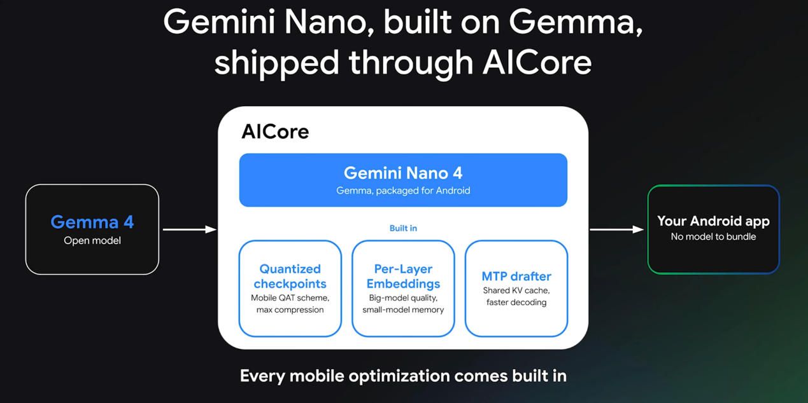
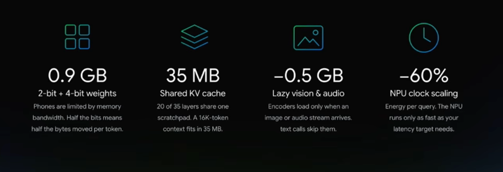
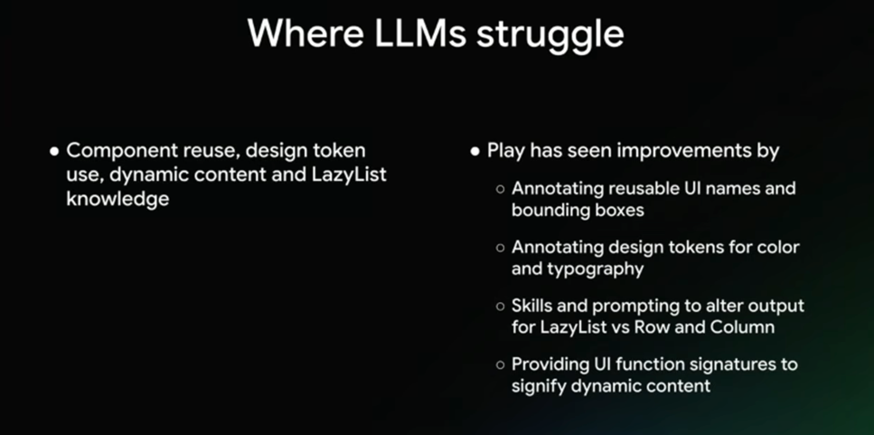

# [The Keynote](https://youtu.be/8Lmv7LGgL4E) 

- Android CLI is great for cheaper models
- Android Prototype lets you run apps quickly in a separate lightweight process
- New Studio feature to migrate XML to Compose
- New set of libraries to manage app state. Making it easier for agents
- A2UI lets agents create their own UI
- New Android MCP
- GoogleBooks
- First Android XR Device. XReal Aura with a live demo of the product.

---

# [The latest in Android dev tools](https://youtu.be/w-auFZP5gJo)

- A lot of new android CLI features
- Rent remote devices for testing from cli 😢
- Run apps directly on Linux using prototype 🤯
- Agents tab in studio caught up with the rest of the world

---

# [Integrate your app with Android Intelligence](https://youtu.be/UsqDEfyOH2E)

### Android MCP 
**Sample App** - [Jetpacker](https://goo.gle/jetpacker)

- Allows Gemini to execute tasks in your apps. Like app intents in iOS
- Expose app data as context to Gemini
- New skill available with `android skills add appfunctions`
- Shipping this requires registering your MCP in Play Console??
- This is an early access feature, you need to apply for access through the QR code at the end of 
the video

---

# [Inside Gemini Nano and Gemma 4](https://youtu.be/ekS4_gV6Ojc)

### What the new Gemma models are capable of On Device

- Offline models only available on some devices. On others, it uses a cloud fallback
- Every Model has its own architecture optimized for its use case
- **Per Layer Embeddings(PLE)** way to optimize model memory requirement. Storing in Flash not RAM
- **Multi Token Prediction(MTP)** Uses a draft model to speed up inference upto 3x and 50% wait time
reduction. It speculates the output of the main model and shares the KV cache with it. Fascinating 
concepts, I will suggest you to look these up
- Exposed in Android through **AI Core**
- Cool demo of the offline capabilities in the video at [24:10](https://youtu.be/ekS4_gV6Ojc?list=PLQZJH-fZcZcc&t=1450)

---

# [Optimizing with MLKit APIs](https://youtu.be/p-SZ1rWvErU)

- A lot of cool breakthroughs in running models offline. Gemini Nano 4 uses significantly less RAM
than before
- MLKit APIs already apply lots of optimizations to make AI integration seamless. It's still closed
source tho
- Gemini Nano 4 (2B) is on par with last year's Gemma 3 (27B) model!! 

### Use Cases
- Speech Translations - 20+ languages supported
- Embeddings - Search app content by meaning
- Text to Speech - Human like voices from text
- Function Calling - In-App Agents

The rest of the talk demonstrates a use case for MLKit APIs. A fraud detection system

:::note
Only a limited list of devices support these features. See the list [here](https://developers.google.com/ml-kit/genai#device-support)
:::

---

# [Scale your app for every screen with Compose](https://youtu.be/SGTkTKX7qq4)

- A lot of explained examples on how to use the [MediaQuery API](https://developer.android.com/develop/adaptive-apps/guides/mediaquery)

:::note
Here "Media" does not mean audio/video. It means the physical medium through which the user is
interacting with
:::

- It can be easily used in Previews too!!
- Explained examples using the [Grids](https://developer.android.com/develop/adaptive-apps/guides/grid)
API for UI Layout
- Both Grids and FlexBox APIs are now Stable!
- Explanation on how the Nav3 Scenes and SceneStratergies work
- End segment dives into the engineering ROI of apps with adaptive screens. 

:::note
This talk is basically a [Navigation 3 Overview](https://developer.android.com/guide/navigation/navigation-3)
:::

---

# [Google Play - Migration to Compose](https://youtu.be/7h_kcpNGKnw)

Fascinating approach they took. **Crawl, Walk, Jog, Run**

- **Crawl** : Converting low traffic screens to compose. Like settings, etc. Goal of developing familiarity with compose
- **Walk** : Converting High traffic components to compose like app bars to understand backwards compatibility and impact to latency and jank.
- **Jog** : High Traffic Pages - fragments within navigation library. Improving latency and jank
- **Run** : Compose navigation and Nav 3. Enabling compose's shared element transitions

Pre compose theming was tedious. Compose theming is easy to use but there are some performance considerations
that I never thought about. The cost of creating a color palette is non-negligible. 

Overall compose makes the code more readable, compact, reusable and debuggable than xml.

Cool thing they shared is where they faced problems while using LLMs and what they did to fix them

They shared some tips to improve UX quality

- Have design templates bundled with color and typography tokens with built in support for light/dark and contrast modes
- Flag hardcoded tokens in the export pipeline
- Train the agent in the component catalog to prevent reinventing patterns

rest are standard architecture and code quality practices with compose

---

# [Graphics features in compose that can elevate your app](https://youtu.be/TirZPDPV8Dw)

Possibly my favorite talk in this summit. Introducing a bunch of new APIs to compose

- [Mesh Gradients](https://developer.android.com/develop/ui/compose/graphics/draw/mesh-gradient)
- [Mesh API](https://developer.android.com/reference/android/graphics/Mesh)
- Support for wide color gamut
- [Polygon Shapes](https://developer.android.com/develop/ui/compose/graphics/draw/shapes)
- [Progressive Blur](https://developer.android.com/develop/ui/compose/graphics/blur/overview)
- Backdrop Render Effects