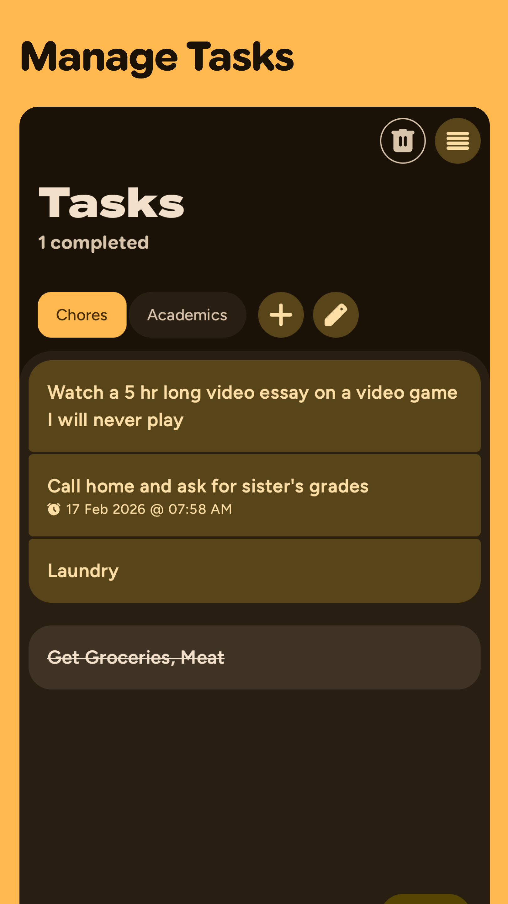
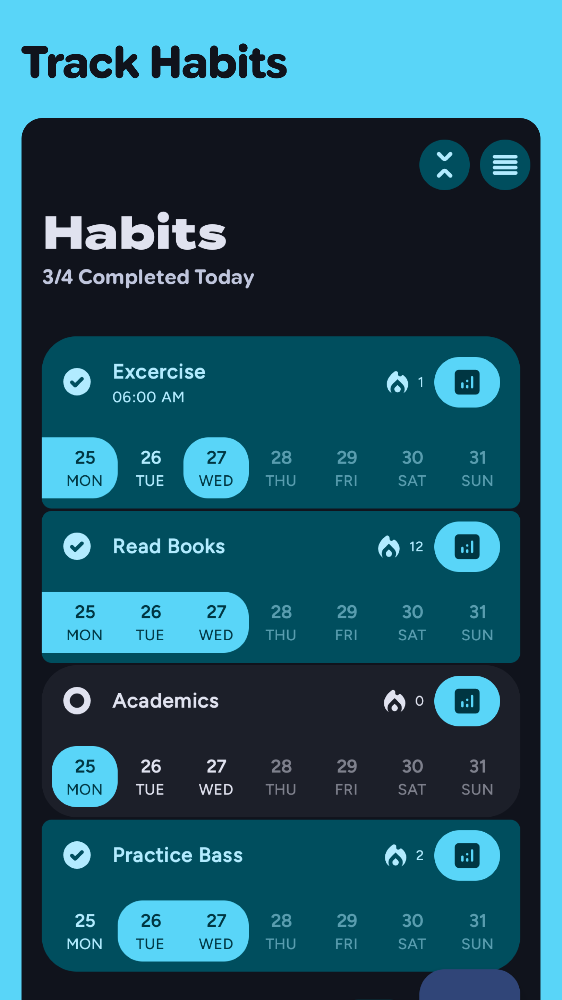
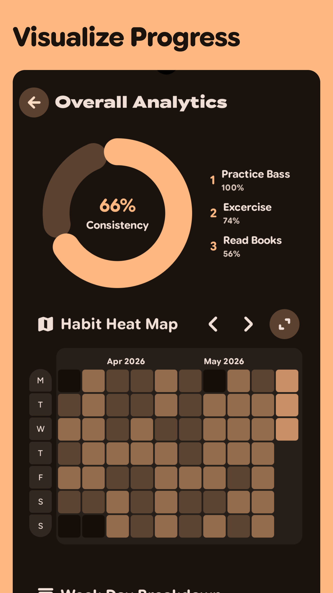
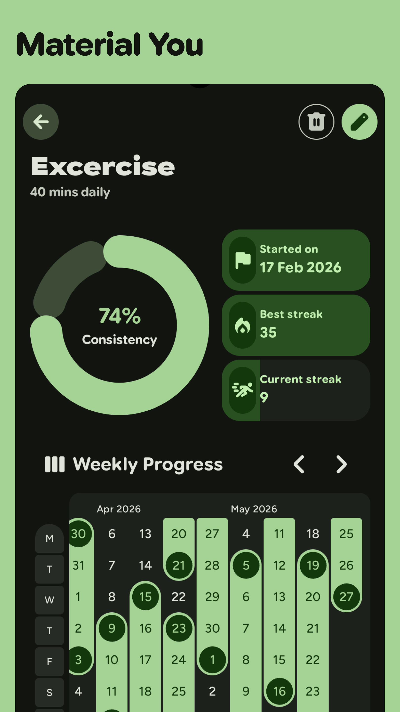

# Screenshots

::github{repo="shub39/Grit"}

|  |  |  |  |
|:-------------:|:-------------:|:-------------:|:-------------:|

# Reflection

I made Grit two years ago as an alternative to [Loop](https://loophabits.org/) with only the features that I needed.
Never thought it will surpass my previous app, Rush in GitHub stars. It's a very trivial stat but I'm proud of it.
Made a video talking about it. 

<iframe
width="100%"
height="468"
src="https://www.youtube.com/embed/sHxqxL8mrKo"
frameborder="0"
allow="accelerometer; autoplay; clipboard-write; encrypted-media; gyroscope; picture-in-picture"
allowfullscreen>
</iframe>

## Crossing 1,000 stars

It's finally done. **Grit just crossed 1,000 stars in GitHub** and I'm really happy about this. I never thought that a simple to-do list — or a simple habit tracker — will cross 1,000 stars in GitHub. I'm just so happy about this.

:::tip
**Word of mouth works.** I haven't spent a single penny in advertising because I don't believe in advertising. If something good exists, it should spread through word of mouth.
:::

> [!NOTE]
> Before diving into this, really a huge thanks to everybody who has starred this on GitHub. A huge thanks to all of the users, the contributors, and the translators for caring about this app.

## What is Grit?

Grit was just an app that I made for myself, but a lot of people have found this app to be really helpful in their lives. I've got a lot of emails and messages thanking me for making this app. And yeah, I'm just really grateful. I'm truly happy that you all have found this helpful in your lives.

So, I want to talk about the technical things of the app:

- How I went about building it
- What else I added to the GitHub repository
- What else I added here

:::important
**No advertising budget.** I think that's a pretty naive thing to say, but I stand by it until someone comes and changes my mind or something.
:::

## First open source experience

And yeah, this was like my **first experience in maintaining a proper open source project** — managing pull requests, managing users, listening to feedback, and implementing it. So, before talking about all the code and stuff, I want to remind you guys about **Keep Android Open**.

## Keep Android Open

> [!WARNING]
> Android is taking their initiative to close and lock down the Android platform through a lot of changes in the way developers publish their app on Play Store. Like every developer needs to hand over their government ID and give them $25 — and you lose any semblance of privacy. They need to make their home address public. If you are an independent developer, you need to make their home address public with Google Play Store to be able to distribute apps on Google Play. And I think that is really unfair.

But now they are saying that you cannot distribute apps without permission from Google Play. You need to be a registered developer to even distribute APK files. And they are implementing this on the hardware level of the device. Like your device will refuse to install the app if it's not from a registered developer. And I think that's really — that is a really bad thing for the Android ecosystem.

I've been using Android since the COVID lockdown. I've been tinkering with it. **I have installed custom ROMs, unlocked many boot loaders, bricked a lot of phones.** And that experience — that sense of fear, that sense of risk that I take every time I completely wipe my device from TWRP or Orange Fox recovery — that sense of terror is just something I used to live for.

:::caution
**They already took this away.** A lot of phones don't come with the ability to unlock their boot loaders anymore.
:::

And with this change, Google just wants to kill side loading apps once and for all. People won't be able to install any APKs outside of Google Play Store. And that's a really bad thing.

> [!IMPORTANT]
> I don't think Google will go back on this, but at least we can try. In the Google IO they didn't show any signs of backing down. So, if you can — **sign this petition**. At least we will know that we tried.

## Design and branding

Moving on. So, this is the banner for the app that I created in **Figma**. I think it's pretty good. I don't know what else to say about it. These are some of the readme badges for the different places this app is available.

:::tip
**Minimal and tasteful.** I tried to make it look minimal — it just feels right, even if I don't have the exact word for it.
:::

## Web demo

I have created a simple **Kotlin Wasm demo app** for this app. It's just web assembly rendering Compose code — so users can see what this app has without even installing it.

:::note
**Under appreciated but expected.** I am the only one who cares about these type of things, and it has almost all the features that you will get on the app.
:::

## Features and analytics

And the habits are there. Then these are the type of analytics you will be able to see within the app:

- **The calendar** — monthly and yearly views
- **Overall analytics** — total consistency across all habits
- **Weekly comparison** — how you performed each week
- **Heat map** — click a day to see completed habits

:::important
**Adaptive navigation.** With Navigation 3 APIs, adaptive screens are built right into the navigation. I'm really excited to try that out.
:::

I tried to make it adapt to tablet screens and phone screens, so it's looking kind of weird in this place. So, I will resize it to a phone UI. So, in the phone UI, it's much better to look at. I will surely work on making it adapt to large desktop screens. With the new Navigation 3 APIs, I saw that adaptive navigation and adaptive screens are built into the navigation. So, I'm really excited to try that out.

And yeah, this is just a simple web demo of the app. So, my app has this task manager screen where you can add tasks, add reminders for that task, add categories, sort tasks, mark them as complete, edit those tasks, etc. So, it's pretty standard task manager that I find useful because this app I made it for myself. I find it very useful. And then there is this habit section, and it allows you to create a habit. I'm creating a habit called test. I can select the days of the week I want to do this habit, and I can add a reminder if I want. After adding that habit and adding that reminder, I can complete a day by simply clicking on that date. And since the starting date, a consistency metric is calculated — out of the total days that you have done since the starting date, how consistent you were. So, this is just that start.

And then there is this monthly progress, which is like a calendar view for the completions. And this is an expanded view of that. Here you can see a calendar that goes up to 2024 and a yearly calendar that goes up to 2024 as well. Then there is this weekly comparison chart where it compares every week how you were performing each week. You can change the time period for comparison from 2 months to 1 year.

**The animation is pretty sweet.** I took this animation from the new Google Health app. That animation is really great and I just love that animation. So, I tried to recreate it here. It has some rough edges — like when I'm going from a larger time range to a smaller time range there is some stuttering I have observed in the mobile app. I don't see any stuttering in the web demo. So, I think I must be imagining things. But yeah, there is some polish left to do.

Then there is this weekday breakdown — how active you are on certain days of the week. Everything animates pretty well. And yeah, this is like for a singular habit the statistics that you get for a singular habit. And then there is this overall analytics section where your total consistency across all the habits is calculated and ranked according to the most consistent habit that you have. Then there is this heat map which also has this monthly and yearly calendar view. Here in the heat map if you click on a day, it will show you the habits that you did in that day. And the same in the yearly calendar. And then there is the weekday breakdown.

:::caution
**Going slow on purpose.** I want to add a lot more analytics later. First I have the idea, then I try to implement it. Then I rigorously test it to see if it conflicts with anything. And yeah, if it makes sense in the app — because I tend to have a lot of nonsensical ideas.
:::

## Design process

There is a **Figma file** that I've created where I try to experiment with ideas. And these are the settings that you will get in the app. Oh, these are all dummy settings because this is a web demo app. So, yeah. That's pretty much it in the app. And such a simple app, it crossed 1,000 stars in GitHub. Again, I'm really grateful to all of the users. I never thought this would happen. And yet, I'm here.

These are the screenshots for the app that I created in Figma, rendered the app in an emulator, took the screenshot, and pasted it, and tried to make it look minimal and, you know, tasteful. I don't know what to say, but it just looks right to me. I don't have a word for it in my mind, but I should. Yeah, it just feels right. I don't know.

## Inspiration

Then, there are some of the features listed here, the motivation of doing this app, and a graph showing the stars over time, the translations and how much they have been translated. **My inspiration for all of this app: Loop Habit Tracker.** It was the habit tracker I was using previously. It was pretty good. It's still a very good option if you want a comprehensive tracker — like, you want to measure every statistic about everything. It's still pretty good, but the UI looks very old, and it's just, yeah, **I wanted to make an app for myself with only the features that I wanted.**

## Contributing

There is a contributing guide for contributors. **If you want to contribute, please open an issue first, then open a pull request.** And yeah, this is pretty much the GitHub page of the app.

## Code and architecture

Now, coming to the code. So, I have an **action-based versioning system**. I don't know what to call it. When I write a change log, the build scripts recognize that a change log has been added. For example, if I write the version 6 change log in this `changelog.md` file, then the build scripts in the app will recognize that a change log has been added. Here I have the logic in the `build.gradle.kts` of the Android app file. It will recognize the changelog.md file and it will transform the changelog from plain text to JSON and store it in the assets directory of the app. And yeah, from there I can display it on the app.

And yeah, these are the GitHub actions that I use. I have an action for beta app. Like in the dev branch, if a workflow starts with this string here, square bracket beta, then it will execute this CI action. It will just make an APK version of the app and upload it on Discord. Then there is the FOSS release. **I have two build flavors of the app:**

- **FOSS flavor** — every feature unlocked
- **Play flavor** — some features paywalled using RevenueCat

No, I'm just kidding about the Play Store suffering part. I just thought it will be a nice side income. But the Play build flavor has some features paywalled and the FOSS build flavor has every feature unlocked. It is the build I'm using for GitHub releases, Aptoide releases, and Izzy Android releases. Then there is this web CI action which builds and deploys the web app that I just showed a few minutes earlier.

## Build modules and MVI

And then there are the build modules. Going on to the build modules, there are **three main modules**:

- **Shared module** — contains all the UI code
- **Shared logic** — implementations needed on all platforms
- **Shared UI** — Compose Multiplatform for shared UI

So, I follow **strict MVI architecture**. MVI stands for **Model View Intent**.

So, for example, for any feature, I divide that feature into three parts: the UI component part, the state part, and the actions part. For example here, for the habits feature, I have a habit state, which is just a container for the state of the habit feature. So, the lists of habits, the completed habits, the settings — everything is just encapsulated in this data class, which is the state. And then there is this habit action sealed interface. This is just the things that the UI can do without implementing the logic of the things that the UI will do. So, the UI can execute on toggle compact view without even knowing what it is actually doing. It just knows that if I toggle compact view, compact view will be toggled. It doesn't know how. And that is the beauty of MVI. Here, the model is the state. The habit state is the model. Then the intent is the habit action. And the view is the UI part of this app.

Here the UI — I have the habits graph. And as Jetpack Compose is structured, you all write all of the UI of your app in composable functions. And this function only takes the state and lambda, which is the on action lambda. It just takes an intent and returns nothing. That's the beauty of Jetpack Compose. The UI will never know what is happening behind the scenes. This makes the UI code really, really modular, and I can just reuse this UI into any other platform — and I just need to implement the details, implement the database, and implement the view models for that platform, but the UI part can be completely shared. And this is what I like the most about Jetpack Compose and Compose Multiplatform. This isolation between things, it just feels right.

So, this Habits graph function is containing all of the view of my app. Everything is contained here. It just takes the state and a lambda, which passes the intent action. Any of the view models or anything that wants to implement that feature needs to implement a view model or a state provider that will trickle down the state — that will create the state, manage it, and trickle it down to the UI. For that, I have created the view models in the build modules itself. Here in the Android app module, this is just a simple Android app. I'm creating the state holders for all of these UI components in this view model package. Then there is the Habit view model, which just creates the state and a bunch of jobs, which is not related to the state, but it is required to do some of the things that the UI requires. It creates the state, manages it, and handles all the actions. So, a habit action is passed to that on action function, and when it's passed, it decides what type of action it is and acts accordingly. Very, very simple, very elegant in code world.

## Navigation 3

So, I'm using the new Navigation 3 libraries — a huge upgrade over the Navigation 2 library that I was using before. In Navigation 2, you had to create a nav controller, and through the nav controller, you would navigate between screens. But in Navigation 3, everything is under your control. The back stack — which is like the list of screens that the app has currently created — the back stack is completely under your control. And that is really powerful for developers. I have created all the possible routes as data objects, which are private to only this file. So, the information about navigation never leaks out of this graph file. A screen doesn't need to know about what other screens are present in the app. And this kind of separation is all I live for.

This is just boilerplate that I need to do in Compose Multiplatform. If this were an Android-only project, this would have been generated. I'm guessing this is where the habits graph starts. This window size class is a custom local composition that I use to know the size of the window that is currently being displayed. There is a scroll behavior for the top app bar. Then there is the nav display composable, which is the root node navigator between the screens. It has a simple DSL-like structure to define all of the routes. I can define a route as entry habit routes — habit list. Then in that lambda, I can just write the compose code. Very simple, very intuitive. And a huge upgrade over Navigation 2.

## Code quality

I'm also using this plugin called **Spotless** — a very powerful Kotlin formatter. It automatically removes unused imports and formats lines. **Really helpful insight:** if a piece of code looks ugly even after formatting, that means I'm doing something wrong in the architecture — probably too much nesting inside that composable.

## Release automation

I might have missed this earlier. I also have a **GitHub action to build and release the app into Play Store automatically**. I just need to push into the master branch with this piece of string in the commit message — and it starts building the Android app bundle and uploads it. **Really seamless.** I had to do this manually before.

## Web bundle size

There's one bottleneck. The web version — the **WASM web version** — is like 12 megabytes. It's web assembly with all compiled Jetpack Compose code. Very heavy. The web demo takes a second to load, but on slower networks it just doesn't load at all.

:::warning
**The trade-off.** I could bundle the web app in the app itself, but it will double the size — from ~10 MB to over 20 MB. And I hate that.
:::

## Closing thoughts

If you want to talk about it, please hit me up. **Please, I'm just dying to talk about it.** It's really hard to find someone else who has the same drive to build things. And I know a bunch of people like that, but they are all online and no one in real life is like that.

> [!TIP]
> If you want to talk about any of these things, if you want to add a feature, or if you want to suggest something — go to the GitHub repository. If you want to try to add a feature by learning Android or KMP, I will be really glad to help. And, that's pretty much it.

---
