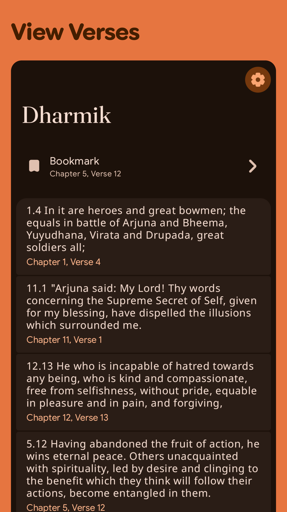
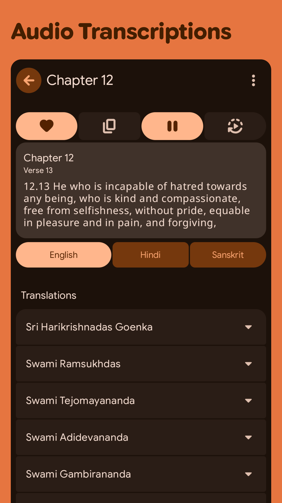
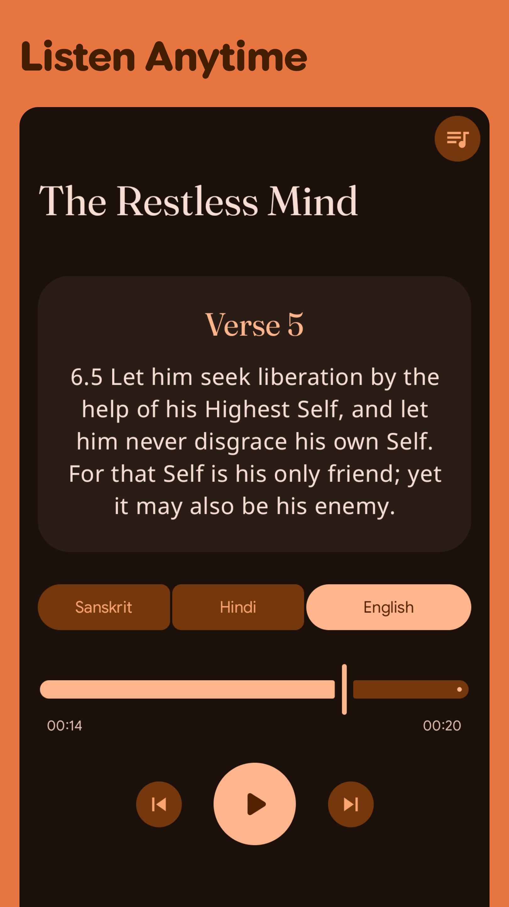
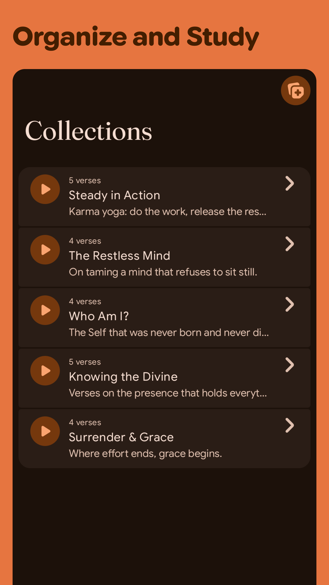

# Prelude

::github{repo="shub39/Dharmik"}

Dharmik was built off a simple Idea. What if there was a clean, no-nonsense app for hindu spiritual texts? I have seen a lot of apps on the
playstore that feel quite bloated and unasthetic. Filled with ads or obnoxious paywalls. So I decided to make my own putting whatever new I 
learnt in android to good use. After shipping it to Playstore and FOSS app stores. I lost Interest in maintaining it and it began to slowly 
accumulate bugs. 

Until recently I got the chance to work with agents. I was keeping a close eye on all the new android tools for agents, ranging from 
android-cli to all the new skills. Through openrouter, I decided to try the new `deepseek-v4.1-flash-1017` running in android cli and 
android-studio's built-in agents tab.

After one year of no updates. The project was basically an unbuildable mess. It was an old single module KMP project but with only one platform
target, Android. With only one automated release workflow. I had stored all the data required for the app (Gita Texts + Audio) in the repo 
itself. 

## The Environment

Because I actively maintained all my other apps myself. I was aware of the latest KMP practices. These things make my workflow very fast

- **KMP's Multi-Module Project Structure** : dividing shared code into a single parent module (`:shared:core`, `:shared:data`, etc) and platform specific build modules like `androidApp` or `desktopApp` depend on it
- **Navigation 3** : The latest and greatest navigation library from google. Making configuring nav destinations and adding metadata top each seamless. Supporting expanded screens was as easy as placing blocks.
- **Koin Annotations** : Effortless, Compile-time checked DI. Not a real DI but makes development way faster. Performance tradeoffs are negligible
- **Revenuecat Setup** : I had revenuecat setup on my other apps already. The agent can simply copy it
- **Posthog Analytics** : Same as revenuecat. The agent just needs to copy it.

With all this context already available from my other projects. The Agent just needed to go through them and migrate dharmik.

---

# The Migration

I restructed the projects such that they shared the same parent dirtectory and asked the agent to plan a migration to new AGP9 stuff as well as
a UI refresh. It went through the other apps and made a list of things it had to change. My earlier work was serving as context for it.

It generated a comprehensive plan listing its proposed changes and any questions it had for me. After going back and forth a bit
it updated the plan and was ready to kick off the migration.

I also asked it to plan two new features separately, 
- **A background Audio feature** so that users can listen to the verses in the background like any other media player
- **A Personal notes/collections feature** - Users can save specific verses in collections with their own notes and listen to the verses as a playlist
- **Bulk Audio Downloader** - Users can download all the audios for listening to them offline anywhere.

The migration went surprisingly smoothly. It picked up a lot of small details from the other apps and implemented them too like

- **Migration to new Room3**
- **Using `kotlinx-datetime` for time related stuff**
- **Platform specific implementation of the media player** : `exoplayer` for androd, stubs for desktop
- **Allocation of data** : Gita texts were stored in-app as compose resorces. Audios were streamed
- **Updated CI** : New CI jobs for publishing the app on GitHub and Palystore separately. 

It made almost no mistakes. As if I made all of those changes myself. I have to see deepseek performed just as well as something like opus 5.5
with the android cli harness. This just taught me that context is just as much important as the model. Having something the agent can actively
compare against really improves the output. 

---

# Conclucsion

|  |  |  |  |
|:-------------:|:-------------:|:-------------:|:-------------:|

This experiment just made the task of maintaining my apps much easier. Now when I want to implement something new myself. I just need to
understand it myself and implement it first in one app. Then ask the agent to copy the implementation onto the other apps. 

One persistant issue I have faced in gradle projects is that there is no concept of an **easy, pluggable, shared library**. Every library
should either be hosted in maven or jitpack or locally which can break CI. Now I can just tell the agent to copy the implementation from one
app to another removing the need for a shared lib or a monorepo altogether. 